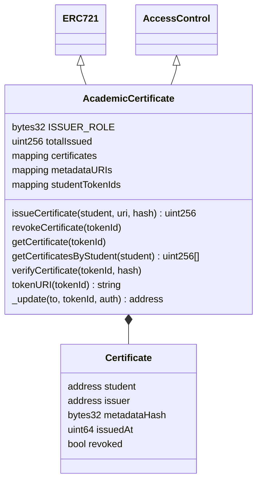
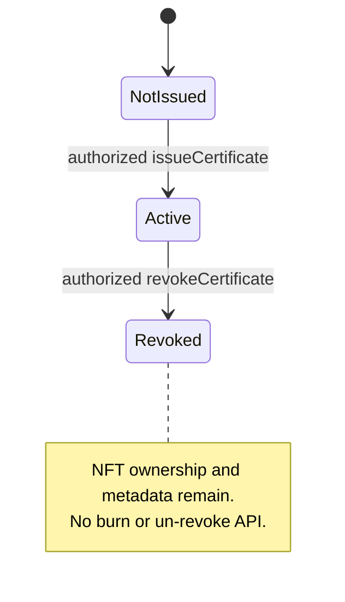

# Academic certificate contract diagrams

These editable diagrams correspond to Section 3 of the six-page report. The PDF draws the same relationships using native vector shapes.

## Inheritance and storage



## Persistent lifecycle



Hash mismatch and unavailable metadata are verification outcomes; they do not change this on-chain lifecycle. Approvals cannot bypass non-transferability.

## Issuance and public verification

```mermaid
sequenceDiagram
    actor User as Issuer or verifier
    participant Web as Web and local JSON storage
    participant Wallet as MetaMask
    participant Chain as Contract and RPC
    User->>Web: Enter student and metadata
    Web->>Web: Save local JSON; fill URI; fetch exact bytes and hash
    Web->>Wallet: Request issueCertificate signature
    Wallet->>Chain: Submit signed transaction
    Chain->>Chain: Check role and inputs; write record/index; safeMint
    Chain-->>Web: Receipt with CertificateIssued tokenId
    User->>Web: Look up token or choose comparison JSON
    Web->>Chain: eth_call getCertificate and verifyCertificate
    Chain-->>Web: revoked and hash comparison
    Note over User,Chain: Public reads require no signature and create no transaction.
```
